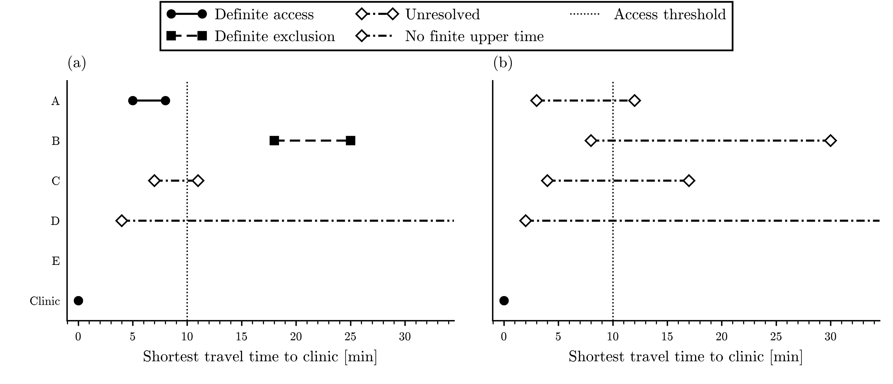

# Results

Executed results verify deterministic travel-time bounds on toy graphs and
software scaling on a current Sofala OSM fixture with synthetic weights.
No real-area Idai baseline or independent WFP evaluation has been qualified.
[ROADMAP.md](../ROADMAP.md) remains the active plan.

[Current-network timing table](sofala-scaling.md) and
[executed source, scaling and upstream compatibility record](../evidence/sofala-scaling/README.md)
cover software behavior only. Historical replication and independent evaluation
retain their existing gates.

Deterministic shortest-time bounds on a toy graph, in minutes to the fixed
destination Clinic, for the 6 nodes A, B, C, D, E and Clinic. Panel (a):
original assumptions. Panel (b): widened assumptions, same axes. Each horizontal
line is one node's interval between its lower and upper travel time. A filled
circle with a solid line means definite access, a filled square with a dashed
line means definite exclusion, and a hollow diamond with a dash-dot line means
unresolved. The dotted vertical line is the 10-minute access threshold; equality
counts as access. No finite upper time exists for D in either panel; that line
runs to the right edge without an end marker. No path exists for E in either
panel, so nothing is drawn on that row; the decision is definite exclusion.
Original: access for A, exclusion for B and E, unresolved for C and D. Widened:
unresolved now also for A and B; a definite decision remains only for E and
Clinic. The bounds are deterministic assumptions, not confidence intervals; no
geography or observed travel time is involved. Exact endpoints: README.md and
bounds.csv beside this figure. Source:
evidence/access-stability-20261006/result.json.
[Caption file](access-stability/bounds.caption.md).

- [Accessible bounds and qualification tables](access-stability/README.md)
- [Bounds CSV](access-stability/bounds.csv) and [qualification CSV](access-stability/qualification.csv)
- [SVG figure](access-stability/bounds.svg) and [render provenance](access-stability/provenance.json)
- [Original result and scientific reproduction](../evidence/access-stability-20261006/README.md)

Rebuild these views with `MPLBACKEND=Agg python analysis/plot_access_bounds.py`.
The [figure guide](../docs/data-and-figures.md) explains scales, encodings and retention.

The [acquired development input record](../evidence/idai-development-inputs/README.md)
updates source availability. Its [executed sensor-date check](../evidence/idai-development-inputs/flood-sensor-dates.json)
and [source review](../evidence/idai-development-inputs/source-review.json) leave
real-area replication blocked.

The detector JSON records, exports and figures in this directory are retained
history. Their [previous results index and reproduction runbook](../docs/history/detector-results.md)
remain available. No detector evaluation or holdout inspection is authorized by
the software pivot. The [history index](../docs/history/README.md) explains scope.
